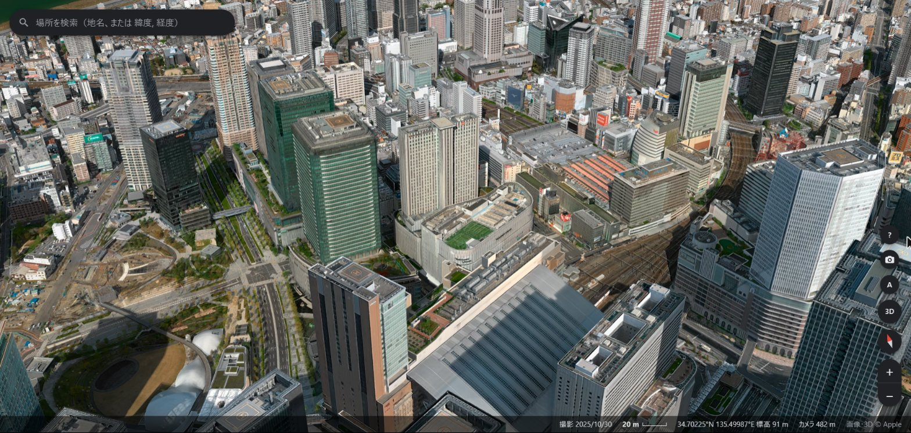
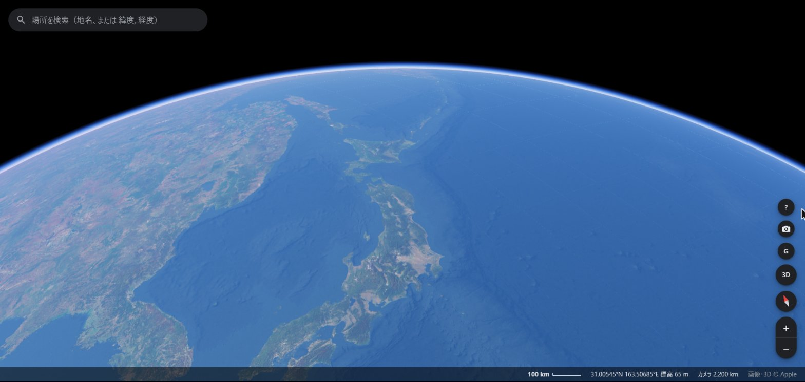
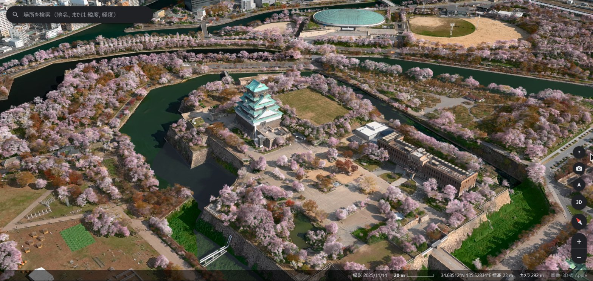
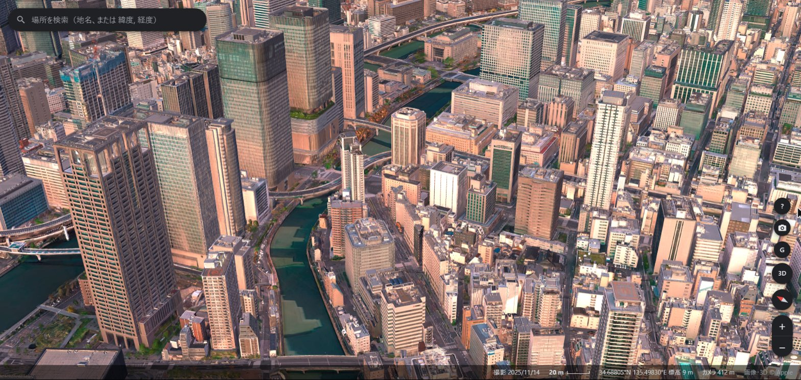

# flyover-web

[日本語](README.md) | English

A tool for viewing Apple Maps Flyover (3D aerial imagery of cities) in a browser on Windows.
It runs on Python alone; no Mac or Apple apps are needed.



| | |
|---|---|
|  |  |
| Zoom in from the whole Earth (with atmospheric haze) | `?season=sakura` turns the trees into cherry blossoms |
|  | |
| `?light=evening` for evening light | |

<sub>The aerial photos, satellite imagery and 3D in the screenshots are from Apple Maps (© Apple). They are shown as examples of what this tool displays.</sub>

> [!WARNING]
> This tool fetches Apple Maps data through interfaces that Apple does not offer to the public. This may violate Apple's terms of service. Use it at your own risk, and do not redistribute the data you fetch. This project is not affiliated with Apple.

## Features

- **Globe viewer**: Zoom in from the whole Earth, and cities with Flyover appear in 3D. The controls are the same as Google Earth
- **The new Flyover of iOS 27**: View the new data, where trees are drawn one by one. You can turn the trees into cherry blossoms or autumn leaves, and change the light to morning, evening, cloudy or night
- **Export**: Save the area around a given point as a set of files you can view in the browser, or as OBJ or glb (3D formats that Blender and similar tools can open)

## Getting started

You need Python 3 (tested with 3.13) and Chrome or Edge. Tested on Windows 11.

```bash
git clone https://github.com/Nao-png/flyover-web
cd flyover-web
pip install -r requirements.txt
python scripts/earth.py --r3d
```

Then open one of these in the browser:

| URL | Viewer |
|---|---|
| http://localhost:8000/gpu.html | **WebGPU version** (recommended). Lighter, and decodes the new Flyover's HEVC photos with the GPU's video hardware |
| http://localhost:8000/ | CesiumJS version (WebGL), for browsers without WebGPU |

- With `--r3d`, the new Flyover is used wherever it exists, and the old one only where it does not. Without it, only the old Flyover is shown
- To use another port, run e.g. `python scripts/earth.py 8080 --r3d`
- Data is fetched from Apple as you view it. Places you have seen are saved in `cache/`, so they load faster the second time

## Globe viewer

Type a place name or "latitude, longitude" in the box at the top left to fly there. The current view is kept in the URL (`#latitude,longitude,altitude,heading,tilt`), so you can bookmark it and open that view later.

### Controls

Press the `?` button at the bottom right or the `?` key to show the list at any time.

| Action | Mouse | Keyboard |
|---|---|---|
| Move | Drag | Arrows |
| Zoom | Wheel, right-drag | PageUp / PageDown, + / - |
| Rotate and tilt | Shift + drag, middle-button drag | Shift + arrows |
| Look around | Ctrl + drag | |
| North up, straight down, both | Click the compass | N, U, R |
| Switch the look (Apple Maps / with atmosphere) | "A / G" button on the right | G |
| Switch between 2D and 3D | "3D" button on the right | O |
| Screenshot | Camera button on the right | P (4K with Shift + P) |

Hold Alt while moving to move slowly.

### URL options

| Add | Effect |
|---|---|
| `?season=sakura`, `?season=momiji` | Trees become cherry blossoms or autumn leaves (with `--r3d`) |
| `?light=morning`, `evening`, `cloudy`, `night` | Removes the shadows from the photos and lights them as morning, evening, cloudy or night (with `--r3d`). With `night`, the WebGPU viewer lights the windows (`?windows=0.3` and so on sets how many, `?bloom=0` turns off the glow, `?time=2` and so on sets the time of night (0–24, default 21), `?traffic=0` stops the car lights) |
| `?sun=200,10` | Puts the sun at any azimuth and height (degrees). The light's color and strength come from the atmosphere (with `--r3d`) |
| `?clouds=0.4` | Cloud amount in the sky (0–1, default 0.3; WebGPU viewer; ported from the clouds of [takram's three-geospatial](https://github.com/takram-design-engineering/three-geospatial); clouds cast shadows on the ground, with haze and light shafts). `?clouds=0` removes the cloud system. The cloud button (C key) shows or hides them |
| `?look=apple`, `?look=google` | The look (same as the G key) |
| `?godrays=0` | Turns off the screen-space light shafts (WebGPU viewer; default 0.35, `?godrays=1` and so on for stronger; not used at night) |
| `?hazeTop=0.8` | Top of the haze layer in km (WebGPU viewer; by default 0.4–1.5 km from the sun's height; `?hazeTop=0` for the old shape) |
| `?phase=0` | Uses the old scattering shape instead of haze that glows strongly around the sun (WebGPU viewer) |
| `?strat=0` | Removes the stratospheric aerosol (default 1; the purple sky on the sun's side after sunset goes away; `?strat=2` and so on to double it) |
| `?raw=1` | Shows the Flyover tiles as received from Apple, decoded in the browser instead of converted to glb on the server (WebGPU viewer; needs a browser that decodes HEVC on the GPU). The new Flyover with `--r3d`, otherwise the old one. `?c3m=1` always shows the old Flyover. Not available with `?light=` (falls back to normal loading) |

## Export

```bash
python scripts/export.py 36.5722 136.6680 --out out/higashi-chaya   # around Higashi Chaya District, Kanazawa
python scripts/serve.py out                                          # http://localhost:8000/higashi-chaya/
```

Use `--r3d` for the new Flyover, and `--obj` or `--glb` to also export OBJ or glb. All options are listed in [docs/how-it-works.en.md](docs/how-it-works.en.md#export-options).

## How it works

1. Like the Apple Maps app, it reads a settings file (the resource manifest) to get the tile URLs and the values used for authentication
2. It requests tiles by position and height slab, and decodes the 3D models it receives (the old C3M format and the new R3D format)
3. It converts them into formats the browser can handle (glb with JPEG or HEVC) and shows them

How the data is fetched, how the viewers are built, the work done to speed up loading, and the file layout are described in [docs/how-it-works.en.md](docs/how-it-works.en.md).

## Tests

Tests for the parts that can be checked without Apple's data:

```bash
python -m pytest tests -q
```

C3M reading has been checked to **match the original Go version bit for bit** on 209 real tiles ([steps](docs/how-it-works.en.md#comparison-with-the-go-version)).

## Credits

- The analysis and implementation of [retroplasma/flyover-reverse-engineering](https://github.com/retroplasma/flyover-reverse-engineering) (Go, archived in 2021) were ported to Python and adapted to Apple's servers as of 2026
- The authentication steps follow the implementation in [sk-zk/streetlevel](https://github.com/sk-zk/streetlevel) (for Look Around)
- The CesiumJS version is drawn with [CesiumJS](https://cesium.com/platform/cesiumjs/), and place search uses [OpenStreetMap's Nominatim](https://nominatim.openstreetmap.org/)
- The WebGPU viewer's clouds are a WGSL port of the cloud shaders of [takram's three-geospatial](https://github.com/takram-design-engineering/three-geospatial) (MIT License, © 2024 Shota Matsuda) (`flyover/earth/gpu-clouds.js`; the noise includes Sébastien Hillaire's TileableVolumeNoise and GLM's Perlin noise, both MIT)
- The roads for the night view's street lights are [OpenStreetMap](https://www.openstreetmap.org/copyright) data (© OpenStreetMap contributors, ODbL), taken from [OpenFreeMap](https://openfreemap.org/) vector tiles (in the [OpenMapTiles](https://www.openmaptiles.org/) schema). The night view also shows this credit on screen
- Per-place brightness for the night view comes from NASA's [Black Marble](https://www.earthdata.nasa.gov/data/projects/black-marble) (2016, VIIRS) via [GIBS](https://www.earthdata.nasa.gov/engage/open-data-services-software/earthdata-developer-portal/gibs-api) map tiles (no registration needed; kept in `cache/blackmarble/`)

## Notes

- Fetched data (`cache/`, `out/`) is Apple's copyrighted material (the roads in `cache/osm/` are OpenStreetMap data under the ODbL). It is kept out of the repository (`.gitignore`). Do not publish or redistribute it
- Apple's servers can change without notice, which may break this tool
- The server only accepts connections from your own PC (127.0.0.1–127.0.0.17)

## License

The parts written for this project are under the [MIT License](LICENSE). The following parts are based on code from retroplasma/flyover-reverse-engineering, which has no license, and are not covered by the MIT License (this project has no right to grant one):

- `flyover/c3m.py`, `flyover/edgebreaker.py`, `flyover/huffman.py` (ports of the Go code), `flyover/earth/c3m.js` (a further port of them to JavaScript)
- `flyover/_fast.py` (a copy of the heavy parts of the two above)
- In `flyover/client.py`, reading the manifest (`_varint`, `_fields`, `Manifest`) and authentication (`TOKEN_P1`, `Client.auth`)

`definitions.glsl` and `functions.glsl` in `flyover/earth/atmosphere/` come from Eric Bruneton's [precomputed_atmospheric_scattering](https://github.com/ebruneton/precomputed_atmospheric_scattering) and are under its license (BSD 3-Clause, [flyover/earth/atmosphere/LICENSE](flyover/earth/atmosphere/LICENSE)). `flyover/earth/atmosphere.js` is a WebGL2 port of its `model.cc` and related code, `flyover/earth/gpu-atmo.js` is a WGSL port of the functions used on screen, and `flyover/earth/sunlight.js` uses the same way of reading the tables, so they also keep that license's notice.

Fetched data and the Apple Maps imagery in the screenshots are Apple's copyrighted material and are not covered by this license.
