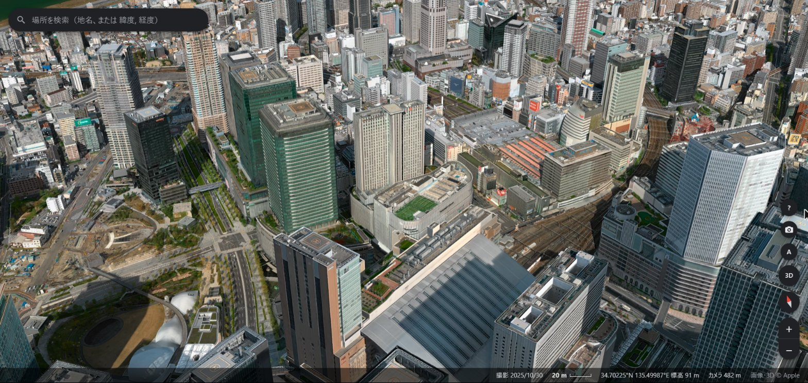
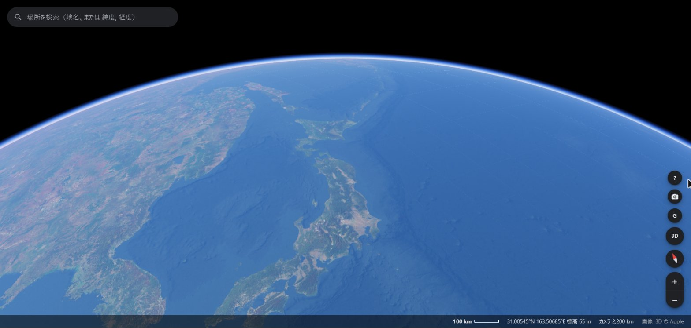
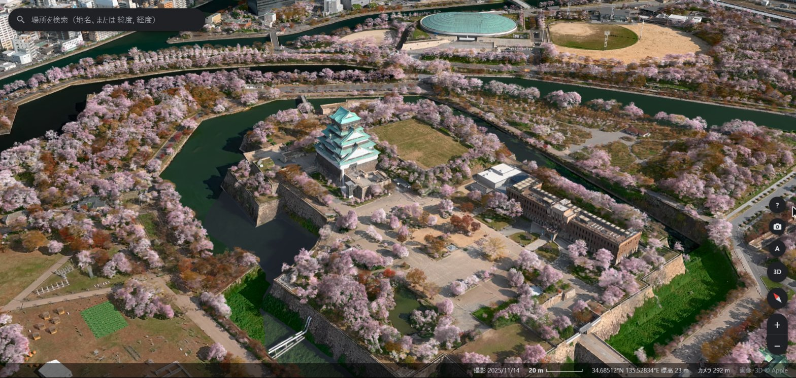
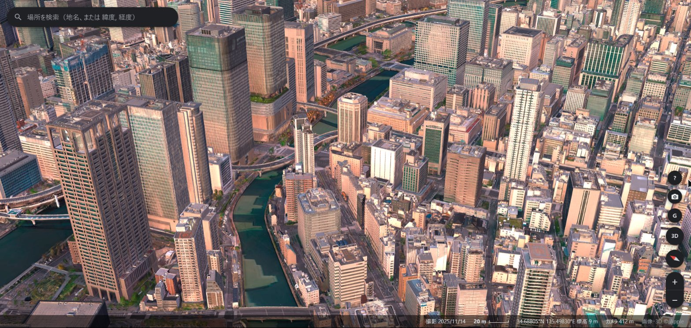

# flyover-web

日本語 | [English](README.en.md)

Apple マップの Flyover（街の 3D 航空写真）を、Windows のブラウザで見るためのツールです。
Python だけで動き、Mac も Apple のアプリも要りません。



| | |
|---|---|
|  |  |
| 地球全体から寄っていける（大気のかすみあり） | `?season=sakura` で木を桜に |
|  | |
| `?light=evening` で夕方の光に | |

<sub>画面写真の航空写真・衛星画像・3D は Apple マップのもの（© Apple）です。このツールで表示した例として載せています。</sub>

> [!WARNING]
> このツールは、Apple が一般には公開していない仕組みを使って Apple マップのデータを取得します。Apple の利用規約に反する可能性があります。使うのは自己責任で、取得したデータを再配布しないでください。このプロジェクトは Apple とは関係ありません。

## できること

- **地球儀ビューア**: 地球全体から寄っていくと、Flyover のある街が 3D で表示されます。操作は Google Earth と同じです
- **iOS 27 の新しい Flyover**: 新しいデータ（木が 1 本ずつ描かれる）で見られます。木を桜や紅葉にしたり、朝・夕方・曇り・夜の光にしたりもできます
- **書き出し**: 指定した地点のまわりを、ブラウザで見られる一式や OBJ・glb（Blender などで開ける 3D の形式）に書き出します

## はじめかた

Python 3（3.13 で確認）と、Chrome か Edge が要ります。Windows 11 で動作を確認しています。

```bash
git clone https://github.com/Nao-png/flyover-web
cd flyover-web
pip install -r requirements.txt
python scripts/earth.py --r3d
```

ブラウザで開きます。

| URL | ビューア |
|---|---|
| http://localhost:8000/gpu.html | **WebGPU 版**（おすすめ）。軽く、新しい Flyover の HEVC の写真を GPU の専用回路で展開します |
| http://localhost:8000/ | CesiumJS 版（WebGL）。WebGPU が使えないブラウザ向け |

- `--r3d` を付けると、新しい Flyover のある所はそれを使い、ない所だけ今までのもので表示します。付けなければ今までの Flyover だけです
- ポートを変えるときは `python scripts/earth.py 8080 --r3d` のように指定します
- データは見るたびに Apple から取得します。一度見た場所は `cache/` に保存されるので、2 回目からは速くなります

## 地球儀ビューア

左上の欄に地名か「緯度, 経度」を入れると、その場所へ飛びます。今の視点は URL（`#緯度,経度,高度,方位,傾き`）に入るので、ブックマークすればその視点から開けます。

### 操作

右下の `?` ボタンか `?` キーで、いつでも一覧を出せます。

| 操作 | マウス | キーボード |
|---|---|---|
| 移動 | ドラッグ | 矢印 |
| 拡大・縮小 | ホイール、右ドラッグ | PageUp / PageDown、+ / - |
| 回転・傾き | Shift + ドラッグ、中ボタンでドラッグ | Shift + 矢印 |
| 見回す | Ctrl + ドラッグ | |
| 北を上に・真上から・両方 | 方位磁針をクリック | N・U・R |
| 色合いの切り替え（Apple マップ / 大気あり） | 右の「A / G」ボタン | G |
| 2D と 3D の切り替え | 右の「3D」ボタン | O |
| スクリーンショット | 右のカメラのボタン | P（4K は Shift + P） |

Alt キーを押しながら動かすと、ゆっくり動きます。

### URL に付けるもの

| 付けるもの | 変わること |
|---|---|
| `?season=sakura`、`?season=momiji` | 木が桜・紅葉になる（`--r3d` のとき） |
| `?light=morning`、`evening`、`cloudy`、`night` | 写真の影を取り除き、朝・夕方・曇り・夜の光にする（`--r3d` のとき） |
| `?sun=200,10` | 太陽を好きな方位・高さ（[°]）にする。光の色と強さは大気から求める（`--r3d` のとき） |
| `?look=apple`、`?look=google` | 色合い（G キーと同じ） |

## 書き出し

```bash
python scripts/export.py 36.5722 136.6680 --out out/higashi-chaya   # 金沢・ひがし茶屋街のまわり
python scripts/serve.py out                                          # http://localhost:8000/higashi-chaya/
```

`--r3d` で新しい Flyover を使い、`--obj` や `--glb` で OBJ・glb にも書き出せます。引数の一覧は [docs/how-it-works.md](docs/how-it-works.md#書き出しの引数) にあります。

## 仕組み

1. Apple マップのアプリと同じように、設定ファイル（リソースマニフェスト）からタイルの URL と認証に使う値を得ます
2. タイルを位置と高さの区分で要求し、届いた 3D モデル（今までの C3M 形式と、新しい R3D 形式）を展開します
3. ブラウザで扱える形（glb と JPEG・HEVC）に変換して表示します

データの取り方、ビューアの作り、読み込みを速くする工夫、ファイル構成は [docs/how-it-works.md](docs/how-it-works.md) にまとめています。

## テスト

Apple のデータなしで確かめられる部分のテストです。

```bash
python -m pytest tests -q
```

C3M の読み取りは、元の Go 版と**ビット単位で一致**することを、本物のタイル 209 枚で確かめています（[手順](docs/how-it-works.md#go-版との照合)）。

## 元になったもの

- [retroplasma/flyover-reverse-engineering](https://github.com/retroplasma/flyover-reverse-engineering)（Go、2021 年にアーカイブ）の解析と実装を Python に移し、2026 年の Apple のサーバーに合わせて直しました
- 認証の手順は [sk-zk/streetlevel](https://github.com/sk-zk/streetlevel)（Look Around 用）の実装を参考にしました
- CesiumJS 版の表示には [CesiumJS](https://cesium.com/platform/cesiumjs/) を、地名の検索には [OpenStreetMap の Nominatim](https://nominatim.openstreetmap.org/) を使っています

## 注意

- 取得したデータ（`cache/`、`out/`）は Apple の著作物です。リポジトリには入らないようにしてあります（`.gitignore`）。公開や再配布はしないでください
- Apple のサーバーの仕様は予告なく変わります。変わると動かなくなることがあります
- サーバーは自分の PC の中（127.0.0.1〜127.0.0.17）からの接続だけを受け付けます

## ライセンス

自分で書いた部分は [MIT ライセンス](LICENSE) です。ただし、ライセンスの表記がない retroplasma/flyover-reverse-engineering のコードを元にした次の部分は、MIT の対象外です（こちらに配布を許す権利がないため）。

- `flyover/c3m.py`、`flyover/edgebreaker.py`、`flyover/huffman.py`（Go のコードの移植）
- `flyover/_fast.py`（上の 2 つの重い部分を書き写したもの）
- `flyover/client.py` のうち、マニフェストの読み取り（`_varint`、`_fields`、`Manifest`）と認証（`TOKEN_P1`、`Client.auth`）

`flyover/earth/atmosphere/` の `definitions.glsl`・`functions.glsl` は Eric Bruneton の [precomputed_atmospheric_scattering](https://github.com/ebruneton/precomputed_atmospheric_scattering) のもので、そのライセンス（BSD 3-Clause、[flyover/earth/atmosphere/LICENSE](flyover/earth/atmosphere/LICENSE)）に従います。`flyover/earth/atmosphere.js` はその `model.cc` などを WebGL2 に、`flyover/earth/gpu-atmo.js` は画面で使う関数を WGSL に移したもの、`flyover/earth/sunlight.js` は同じ表の引き方を使うものなので、同じライセンスの表記も守ります。

取得したデータと画面写真の Apple マップの画像は Apple の著作物で、このライセンスの対象ではありません。
